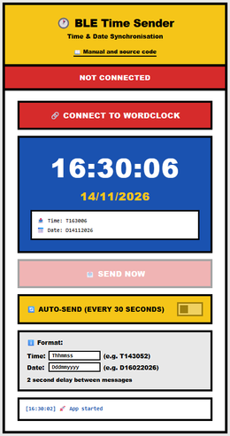
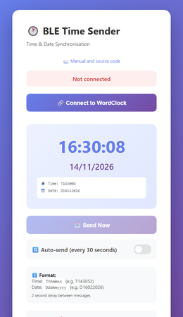
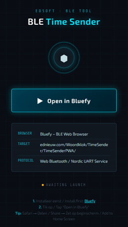
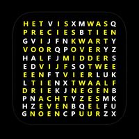

# HTML-TimeSender

HTML page that connects to a BLE UART client and sends time and date to it. We use the web page interface "Web Bluetooth" to make the BLE-connection.

This web page is developed to send time and date from a cellular to my word- and other clocks when no WIFI is available to receive time by WIFI/NTP. 
More about my word clocks and other projects: [github.com/ednieuw](https://github.com/ednieuw)

## Choose your version

Use Chrome or Edge (Android, Windows, macOS). Click a picture to start.

iOS users can not use the web page method due to security reasons but can use the Bluefy method: choose **iPhone / iPad** (right) and see [iOS workaround](#ios-workaround) below. 
On macOS Tahoe "Web Bluetooth" can be used.

<table>
<tr>
<td align="center" valign="top" width="25%">
 
<b><a href="https://ednieuw.com/Woordklok/TimeSender/TimeSender.html">Mondriaan style</a></b> 
Opens in the browser
</td>
<td align="center" valign="top" width="25%">
 
<b><a href="https://ednieuw.com/Woordklok/TimeSender/TimeSenderSoft.html">Soft style</a></b> 
Opens in the browser
</td>
<td align="center" valign="top" width="25%">
 
<b><a href="https://ednieuw.com/Woordklok/TimeSender/TimeSenderPWA/">Install as app</a></b> 
Android and Windows 11. Open in Chrome or Edge and tap <i>Install app</i>. The clock icon is placed on your home screen or in the Start menu.
</td>
<td align="center" valign="top" width="25%">
 
<b><a href="https://ednieuw.com/Woordklok/TimeSender/TimeSenderPWA/bluefy-launcher.html">iPhone / iPad</a></b> 
Install <a href="https://apps.apple.com/nl/app/bluefy-web-ble-browser/id1492822055?l=en-GB">Bluefy</a> first, then open this launcher. <a href="#ios-workaround">More info</a>
</td>
</tr>
</table>

## Manual

Scan the QR code in the manual or click a link:
- [Manual and QR codes on one web page (English and Dutch)](https://ednieuw.com/Woordklok/TimeSender/QRappTimeSender.html)
- [Manual in English (PDF)](https://ednieuw.com/Woordklok/TimeSender/TimeSenderPWA/handleiding/Manual_TimeSender_UK.pdf)
- [Handleiding in het Nederlands (PDF)](https://ednieuw.com/Woordklok/TimeSender/TimeSenderPWA/handleiding/Handleiding_TimeSender_NL.pdf)
- QR codes: [app (PNG)](https://ednieuw.com/Woordklok/TimeSender/TimeSenderPWA/handleiding/qr-timesender.png), [iPhone launcher (PNG)](https://ednieuw.com/Woordklok/TimeSender/TimeSenderPWA/handleiding/qr-iphone-launcher.png)

## For more info

- [My GitHub pages](https://github.com/ednieuw)
- [My word clock pages](https://github.com/ednieuw/Arduino-ESP32-Nano-Wordclock)
- [The Arduino Time receiver sketch](https://github.com/ednieuw/BLE-TimeReceiver)
- [ESP32 communications](https://github.com/ednieuw/ESP32Communications)

## iOS workaround

On iPhone/iPad: **first install the free Bluefy browser** from the App Store: [Bluefy - Web BLE Browser](https://apps.apple.com/nl/app/bluefy-web-ble-browser/id1492822055?l=en-GB). 
Then open the [iPhone launcher page](https://ednieuw.com/Woordklok/TimeSender/TimeSenderPWA/bluefy-launcher.html) in Safari and tap "Open in Bluefy".

<table>
<tr>
<td></td>
<td>Alternatively use my own iPhone/iPad app <a href="https://apps.apple.com/nl/app/bluetooth-uart-time/id6760344877?l=en-GB">Bluetooth UART time</a> from the App Store. A similar app for sending time and date.</td>
</tr>
</table>

## Web Bluetooth support (march 2026)

### Browsers with full support

Chrome / Chromium-based browsers are the only ones with solid, out-of-the-box Web Bluetooth support. A subset of the Web Bluetooth API is available in ChromeOS, Chrome for Android 6.0, Mac (Chrome 56), and Windows 10 (Chrome 70).

- Chrome on Android – supported since Chrome 56 (Android 6.0+)
- Chrome on macOS – supported since Chrome 56
- Chrome on Windows – supported since Chrome 70, requires Windows 10 version 1703 (Creators Update) or later
- Chrome on ChromeOS – fully supported
- Edge (Chromium-based) – supported since version 79
- Opera on Android – supported since version 46
- Samsung Internet – the GATT Communication API is shipped without any flag in Samsung Internet v6.4

### Browsers without support

- Firefox – not implemented; Mozilla has concerns about the security model
- Safari / WebKit – not supported across all versions of Safari; this affects all browsers on iOS/iPadOS since Apple forces them to use WebKit
- Chrome on Linux – partially implemented but not supported; the #enable-experimental-web-platform-features flag must be enabled

### Important requirements

- Web Bluetooth is only available in secure contexts (HTTPS).
- It is still considered experimental, so treat it accordingly in production projects.
- It only works with Bluetooth Low Energy (BLE/GATT) – not Classic Bluetooth. For Classic Bluetooth with RFCOMM, the Web Serial API is the alternative.

Bottom line for ESP32 BLE projects: Chrome on Android, macOS, and Windows are your reliable targets. iOS remains the main gap unless users install a dedicated app like Bluefy.
